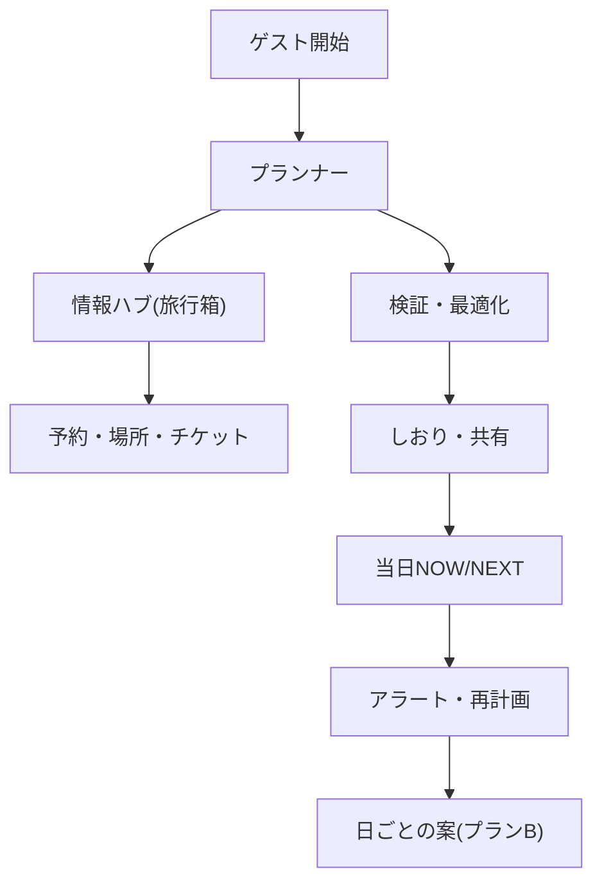

# 04 外部機能仕様書 画面仕様 v6.0(正本)

> 文書ID: DOC-04 / 版: **v6.0** / 状態: APPROVED FOR IMPLEMENTATION(利用者の指示 2026-11-17 で v6.0 へ改訂。main への取り込みで発効) 
> **正本の場所: このファイル。** 旧版 v5.1(資料室 `04_外部機能仕様書_画面仕様_v5.1.md`、2026-09-03 発効)と DOC04-A v5.1(高忠実度ワイヤーフレーム)は保管。 
> 共通正本: 要件ID=DOC-02、画面ID=DOC-04、データ=DOC-05、API=DOC-06、Security=DOC-11、語彙=DOC-13(所在は `docs/spec/CANONICAL-SOURCES.md`)

**目的:** 全画面の利用目的、情報、操作、権限、状態、失敗時、レスポンシブ、アクセシビリティを定義する。

## 0. v6.0 の改訂点

| # | 変更 | 根拠 |
|---|---|---|
| 1 | 画面 ID と実装の画面の経路(route)の対応表を追加(§19)。FR ごとの対応は `docs/trace/FR-TRACE.md` | 監査 G-01・G-11 |
| 2 | 実装済みで v5.1 に画面 ID の無かった画面を **SC-44〜48** として追加(旅行箱・旅行相談・旅行の下書き・料金と利用枠・写真の投稿)。正準値は **SC 48** | 実装の記録(DOC-10)と `docs/ux/` |
| 3 | **SC-17 を「日ごとの案(プランB)」へ置き換え**(旧 What-if／ブランチの画面は廃止。旧 URL は旅程へ案内) | DOC-02 v6.0 FR-019 |
| 4 | SC-07 今日の画面は「旅帖ライブ」の構成(§4 SC-07 の v6.0)。地図の線は直線の目安として示し、道順は外の地図アプリへ | `docs/ux/TDay_旅の当日_旅帖ライブ.md`・監査 G-07 |
| 5 | **DOC04-A(視覚の正本)は本書へ統合。** 視覚の正本は「実装の画面と `docs/ux/` の仕様・モック」(§20)。v5.1 のワイヤーフレームは保管 | 実装が v5.1 の WF から変わったため |
| 6 | 移動手段の名前・アイコン(DOC-13 v6.0 §15)、AI でない規則の生成の表示(SC-28・SC-42) | `docs/ux/G11_UIUX全範囲_実装仕様.md` §4・監査 G-14 |

v5.1 の本文(§1〜§18・SC-33〜43・遷移の規範・ビジュアルの正本)は削らずに引き継ぎ、変わった所に「**v6.0:**」で書き足した。

## 1. UI設計原則

1. 当日情報優先: 旅行期間中はダッシュボードより当日画面を既定入口にできる。
2. 一元情報: 画面ごとに値を複製せず、同一エンティティを異なるビューで表示する。
3. 重要情報1操作: NOW/NEXTから地図、予約、チケット、電話へ1操作。
4. 秘密の段階表示: 予約番号やQRはマスクし、タップ・再認証・監査を適用可能。
5. 出典表示: 営業時間・料金・運行・AI候補には取得元と時刻を表示する。
6. 楽観的UIの節度: 重要保存はサーバー確定前に成功表示しない。
7. 失敗から回復: 入力を失わず、手動代替・再試行・オフラインを示す。
8. モバイルファースト: 屋外、片手、低電波、日光下、急いだ状態を基準にする。
9. **v6.0:** 推定・概算・直線の目安を、実測・道順・確定値に見せない。生成の方法(規則か AI か)を示す。

## 2. グローバル情報設計

### 2.1 固定ナビゲーション

| モバイル | デスクトップ | 内容 |
|---|---|---|
| 今日 | 今日 | NOW/NEXT、当日行程、アラート |
| 計画 | プランナー | 日程・候補・地図 |
| 旅行箱 | 情報ハブ | 予約、チケット、文書、場所、費用 |
| 共同 | メンバー | 投票、コメント、変更、役割 |
| その他 | 設定 | 持ち物、出力、履歴、設定 |

**v6.0:** 旅行箱は SC-44(`/planner/:id/kit`)。中のナビは 概要・予約/チケット・準備/持ち物・予算/費用・文書・予約の取込・検索。

### 2.2 グローバルコマンド

- 全体検索
- クイック追加
- QR/文書スキャン
- 音声入力
- 同期状態
- 通知
- アカウント／旅行切替
- 緊急情報

### 2.3 共通バッジ

| バッジ | 意味 |
|---|---|
| 確認済 | 一次情報または利用者確認済み |
| 取込 | 原本から抽出、確認状態を併記 |
| 推定 | AIまたは計算値 |
| 要再確認 | 鮮度期限超過 |
| 矛盾 | 複数ソース不一致 |
| オフライン | 最終同期スナップショット |
| 非公開 | 本人または限定権限だけ |

**v6.0:** 当日の移動時間は出どころ(実時刻・手入力・登録した移動・概算・不明)を併記する(DOC-13 v6.0 §16)。

## 3. 画面一覧

| ID | 画面 | 主対象 | Gate |
|---|---|---|---|
| SC-01 | ランディング | 訪問者 | G1 |
| SC-02 | ゲスト開始 | 未登録 | G0-G1 |
| SC-03 | ログイン・登録・回復 | 全利用者 | G0 |
| SC-04 | 旅行一覧 | 登録者 | G0 |
| SC-05 | 旅行作成・基本設定 | 所有者 | G0 |
| SC-06 | プランナー | 所有者・編集者 | G0-G3 |
| SC-07 | 今日／NOW-NEXT | 旅行者 | G1-G4 |
| SC-08 | 候補箱 | 全メンバー | G1-G2 |
| SC-09 | 場所詳細 | 権限者 | G2 |
| SC-10 | 全体検索 | 権限者 | G2 |
| SC-11 | 予約一覧・詳細 | 権限者 | G2 |
| SC-12 | チケット・QR | 限定権限 | G2 |
| SC-13 | 文書取込・レビュー | 所有者・編集者 | G2-G5 |
| SC-14 | 移動・経路比較 | 編集者 | G2-G3 |
| SC-15 | 制約・実行可能性 | 編集者 | G3 |
| SC-16 | 最適化結果 | 編集者 | G3 |
| SC-17 | **日ごとの案(プランB)**(v6.0 で旧 What-if／ブランチを置き換え) | 編集者・旅行者 | G4-G6 |
| SC-18 | メンバー・権限 | 所有者 | G1-G5 |
| SC-19 | 投票・合意 | 全メンバー | G5 |
| SC-20 | コメント・変更履歴 | 権限者 | G1-G5 |
| SC-21 | 持ち物 | 権限者 | G2-G5 |
| SC-22 | 準備レディネス | 権限者 | G2-G5 |
| SC-23 | 費用・精算 | 限定権限 | G5 |
| SC-24 | アラート・再計画 | 旅行者 | G4 |
| SC-25 | しおりデザイン | 編集者 | G1-G2 |
| SC-26 | PDF・印刷・公開設定 | 所有者 | G1-G2 |
| SC-27 | 連携・入出力 | 所有者 | G5 |
| SC-28 | 写真・旅行記 | 権限者 | G6 |
| SC-29 | プライバシー・セキュリティ | 本人 | G2-G6 |
| SC-30 | 通知・表示設定 | 本人 | G1 |
| SC-31 | 組織管理 | 組織管理者 | G6 |
| SC-32 | サービス管理 | 運用管理者 | G0-G6 |
| SC-33〜43 | v5.1 追加画面(§4 の後半) | — | G1-G6 |
| SC-44 | **旅行箱(情報ハブ)**(v6.0 追加) | 旅行のメンバー | G2 |
| SC-45 | **旅行相談**(v6.0 追加) | 登録者 | FR059 |
| SC-46 | **旅行の下書き**(相談から作る、v6.0 追加) | 登録者 | FR059 |
| SC-47 | **料金・利用枠**(v6.0 追加) | 本人 | G6 |
| SC-48 | **写真の投稿(QR から開く)**(v6.0 追加) | 同行者(未登録可) | G6 |
| SC-49 | **スポットモード**(自由に歩くエリアを地図で歩く、v6.0 追加) | メンバー | SpotMode |
| SC-50 | **自由に歩くエリアの準備**(v6.0 追加) | 編集者 | SpotMode |

## 4. 画面詳細

### SC-01 ランディング

**目的:** 登録なしで即開始でき、製品が「しおり作成」だけでないことを伝える。

**主要要素:** ブランド約束、ゲスト開始CTA、サンプル旅行、情報一元化のデモ、セキュリティ説明、料金、ログイン。

**受入:** CTAからSC-02へ1操作。Cookie同意前に不要な分析を開始しない。サンプルに実予約番号を使わない。

### SC-02 ゲスト開始

**入力:** 旅行名、目的地、期間、タイムゾーン。全て後編集可。
**処理:** ゲストセッションと旅行を作成。
**成功:** SC-06を開き、初期チュートリアルを最小表示。
**失敗:** 入力保持、ローカル下書き、再試行。
**警告:** ブラウザデータ削除時の回復方法と保存期限を明示。

### SC-03 ログイン・登録・回復

ログイン、登録、メール確認、パスワード再設定、パスキー/MFA、ゲスト昇格、既存アカウント統合を状態別に分ける。エラーはアカウント存在を過度に漏らさない。全端末ログアウト、セッション再利用検出時の通知を提供する。

### SC-04 旅行一覧

**表示:** 進行中、予定、終了、共有、下書き、ゴミ箱。カードには表紙、期間、目的地、メンバー、準備率、未解決警告、最終更新、オフライン状態。
**操作:** 新規、複製、テンプレート化、アーカイブ、削除、検索。
**秘密:** カードのOSプレビューで予約情報を出さない。

### SC-05 旅行作成・基本設定

旅行名、期間、タイムゾーン、基本通貨、旅行タイプ、参加予定者、出発地、テーマを設定する。日付変更時はイベント、予約、出力への影響を事前表示する。

### SC-06 プランナー

#### レイアウト

- デスクトップ: 左=日付、中央=タイムライン、右=候補/地図/情報詳細。
- タブレット: タイムライン＋切替ドロワー。
- モバイル: 日付横スクロール＋縦タイムライン＋ボトムシート。

#### イベントカード

名称、時刻、所要時間、場所、移動、予約状態、料金、参加者、情報鮮度、ロック、警告を表示。タップで詳細。地図、予約、チケット、電話はクイックアクション。

#### ドラッグ&ドロップ

- 同日・別日移動、複数選択、Undo。
- 変更中に移動不足・予約衝突をプレビュー。
- キーボード代替、スクリーンリーダー操作を提供。
- 他人が編集したrevisionと衝突した場合は確定前に比較。

#### 状態

空、読込中、保存中、保存済、未同期、競合、権限なし、外部情報期限切れを区別する。

**v6.0:** 日の見出しに日ごとの案のタブ(SC-17)。控えの案を開いている時は「控えの案を見ています」の帯と「この案に切り替える」。

### SC-07 今日／NOW-NEXT

**最上段:** 日付、現地時刻、同期時刻、接続、重大アラート。
**NOW:** 現在イベント、残り、場所、予約、チケット、参加者、電話。
**NEXT:** 出発推奨時刻、経路、所要、必要物、遅延見込み。
**下部:** 今日の縦タイムライン、空き時間、代替候補、緊急情報。

重要なQRはマスク状態から明示タップで全画面表示する。オフライン時は「最新」と誤解させず最終同期時刻を常時表示する。

**v6.0(旅帖ライブ):** 上から ライブ帯(何日目・押印・写真)、旅の糸(済み・いま・これから)、出発の合図(4 段階)、次の場所のチラ見せ
(写真の出典・営業時間・天気・予約)、空模様の時刻の線(雨にかかる屋外の予定はプランBへ)、当日の地図、寄り道の候補(影響を見てから足す)、
旅帖(着いたら印・写真・音声・ひとこと)、同行者(到着の予定の共有、位置は送らない)、お助け(緊急の連絡先)、移動モード。
地図の線は予定の地点を**直線で結んだ目安**で、位置の記録を使う時だけ実線の「足跡」。道順は「外の地図で案内」で外の地図アプリへ渡す。
移動時間の出どころと、取得した値の時刻(天気・保存の時刻)を出す。詳細は `docs/ux/TDay_旅の当日_旅帖ライブ.md`。

### SC-08 候補箱

URL貼付、画像、音声、テキスト、地図検索、共有受信を統合する。候補カードは元URL、投稿者、AI抽出、重複、投票、旅程配置状態を示す。外部Webの命令文をAI命令として処理しない。

### SC-09 場所詳細

正式名、別名、写真、住所、地図、入口、電話、URL、営業時間、休業、価格帯、予約、アクセシビリティ、注意、関連イベントを表示する。住所タップでアプリ内地図、電話は確認後発信、営業時間は対象日と取得時刻を併記する。矛盾時はソース比較を表示する。

### SC-10 全体検索

入力と同時に日程、場所、予約、チケット、文書、費用、メンバーをカテゴリ表示する。予約番号は末尾検索を可能にしても結果画面ではマスクする。権限外カテゴリの存在件数も返さない。

**v6.0:** 旅行の中の検索は旅行箱の検索(`/planner/:id/kit/search`。固定の絞り込み 今日・予約・チケット・ホテル・緊急)。

### SC-11 予約一覧・詳細

#### 一覧

日付、種類、名称、状態、支払、取消期限、未確認、旅行イベント紐付けを表示。宿泊・航空・鉄道等でフィルタ。

#### 詳細

予約番号、PIN、名義、人数、日時、タイムゾーン、住所、電話、金額、支払、取消条件、原本、関連イベント、チケットを表示。秘密値は部分マスクし、表示・コピーを監査する。コピー後クリップボード消去を可能な範囲で支援する。

### SC-12 チケット・QR

全画面コード、コード種別、利用区間、名義、日時、オフライン保存、原本、注意を表示。画面輝度、回転、拡大を制御する。期限切れ・使用済み・取消済みは明示する。共有相手にコード権限がない場合、APIからもpayloadを返さない。

### SC-13 文書取込・レビュー

1. メール転送、連携、ファイル、カメラを選択。
2. アップロードと安全検査。
3. OCR/抽出進捗。
4. 左に原本、右に抽出項目と根拠箇所。
5. 信頼度低・矛盾・必須欠落を強調。
6. 利用者が修正・確定。
7. 既存予約との重複、更新、取消を選択。

抽出失敗でも原本を閲覧し手動登録できる。

**v6.0:** 1 通に予約番号が 2 つ以上ある時は予約ごとに分けて取り込む。AI で補った値は「AI の読み取り」と出し、確かめる対象にする。

### SC-14 移動・経路比較

出発・到着、時刻、手段、運賃、徒歩、乗換、アクセシビリティ、荷物、信頼度、取得時刻をカード比較する。地図経路と旅程への影響を同時表示。手動区間も登録できる。

### SC-15 制約・実行可能性

重大度別に違反を表示し、該当イベント、根拠、影響、修正候補へリンクする。検証不能は独立セクションに置く。「制約ゼロ」と「未検証」を同じ表示にしない。

### SC-16 最適化結果

元案と候補A/Bを比較し、移動時間、費用、希望充足、公平性、疲労、違反数を表示する。移動したカードを色と矢印で示し、変更理由を自然言語と数値で提示する。適用、却下、条件変更、部分採用を提供する。

### SC-17 日ごとの案(プランB)(v6.0 で置き換え)

- **旅程(日別):** 日の見出しに案のタブ(● 今の案・理由のアイコン・⚠ つながりの注意)と「案を作る」。控えの案を開くと帯と「この案に切り替える」「比べる」「前後のつながりを確かめる」。地図は開いている案(控えは点線)。
- **案を作る:** 元(この日の今の案を写す/別の日を写す/白紙)・名前・理由(雨・人数・移動手段・遅れ・疲れ・予算・休業・その他)・条件・たたき台・まとめて作る。
- **比べる:** 予定数・移動・歩く時間・費用の見込み・予約の過不足・前後のつながりを 2 列で。
- **切り替えの確認:** 前後のつながり・使わなくなる予約(取り消しの手続きの準備だけ、外へ送らない)・未予約・理由・通知・任意の AI の確かめ(利用枠を使う)・元に戻す。
- **今日(旅行中):** 今の時刻と今いる所(位置を送らずに予定・地名を選べる)から、控えの案ごとの合流点と移動・間に合うか。
- **旅の記録:** 日ごとに回った案と切り替えの点。
- 旧の What-if／ブランチの URL(`/planner/:id/branches…`)は旅程へ案内する。
- v5.1 の記述(保管): 雨、遅延、欠席、予算、体力をテンプレートから選択し、本案を壊さず分岐を生成する。各ブランチの差分、最終更新、作成者、採用状態を表示する。

### SC-18 メンバー・権限

招待、リンク、役割、フィールド権限、最終アクセス、招待状態、位置共有状態を管理する。所有者移譲、メンバー削除、全リンク失効は再確認する。所有者が一人もいなくなる操作は禁止する。

### SC-19 投票・合意

**v6.0(Gate ChatConsensus。画面名は「相談」。経路 `/planner/:planId/discussion`):** タブを使わず、1つの画面に上から
「決まったこと」「投票」「話し合い」を並べる。

- **決まったこと:** 「これで決まり」で記録したこと(話し合いで決定・記録した人・元の発言)と、投票で決まったこと。
  旅程に反映(確認の画面で何が変わるかを確かめてから)・反映を元に戻す・削除(反映の前だけ)。
- **投票:** かんたん投票は選択肢ごとに「これにする」(押すと選択中。もう一度で取り消し。別のを選ぶと前の選択は外れる)・票の数と
  選んだ人(匿名では3人未満の間は数を出さない)・まだ選んでいない人・編集者の「これに決定」。詳しい投票は v5.1 の内容のまま
  (Love/OK/懸念/不可・理由・代替案・合意状態・定足数・同点)。
- **話し合い:** SC-20 の旅行全体のスレッド。編集者以上には発言ごとに「これで決まり」「投票にする」を出し、その発言から作った
  投票・決定を発言の下に示す。閲覧者には作る操作を出さない。
- **投票の作成:** 題名・選択肢・候補箱から選ぶ・「話し合いから選択肢の案を出す(AI・任意)」。締切・匿名・説明・
  「4段階で答える」(→ 不可の扱い・定足数)は「詳しい設定」に畳む。
- 操作のボタンの名前は見える文字を含める(例「これで決まり(この発言): …」。WCAG 2.5.3)。

v5.1: 候補ごとにLove/OK/懸念/不可、理由、代替案を入力する。誰が未回答か、秘匿回答の有無、合意条件を示す。秘匿制約の詳細は表示しない。

### SC-20 コメント・変更履歴

**v6.0:** 旅行全体へのコメントは「相談」(SC-19)の「話し合い」として出す(入力欄の名前は「発言する」)。予定・予約・費用への
コメント(`?target=…&id=…`)は、その対象のコメントだけを出す。

対象別スレッド、メンション、解決、変更セット、差分、Undoを表示する。秘密情報をコメントへ貼ろうとした場合は検知警告する。履歴は誰が、いつ、何を、なぜ変更したかを示す。

### SC-21 持ち物

個人／共有、担当、数量、購入、梱包、必須、使用後を管理する。天候・活動変化による提案は自動確定せず追加候補として出す。薬等は非公開設定を既定選択可能にする。

### SC-22 準備レディネス

予約、支払、文書、持ち物、担当、情報鮮度、回答を割合と問題一覧で表示する。単なる進捗率で重大未完了を隠さない。出発までの期限順に並べる。

### SC-23 費用・精算

計画／予約／実費、カテゴリ、人、日、通貨を切替表示。支払者・負担者・分割方式、領収書、返金、精算を管理する。個人予算は共有範囲を設定し、他人の非公開予算を集計から推測できないようにする。

### SC-24 アラート・再計画

影響イベント、外部ソース、取得時刻、確度、利用者確認を表示する。再計画案A/Bは守る予約、失う予定、時間差、費用差、通知対象を示す。承認後に変更セットを適用し、共同者へ差分通知する。

**v6.0:** 再計画の候補は「この日の案として保存」でき、保存すると SC-17 の切り替えになる。

### SC-25 しおりデザイン

テーマ、表紙、色、書体、写真、セクション、密度を選ぶ。自由配置よりデータ整合性を優先し、値更新で崩れないテンプレート制約を設ける。プレビューはWeb/PDF/印刷を切替。

### SC-26 PDF・印刷・公開設定

出力範囲、ページ、地図、予約、QR、連絡先、費用、参加者、持ち物、白黒、冊子を選択する。秘密値を含む選択には警告し、公開URLでは既定除外する。版番号、生成時刻、情報基準時刻を印字する。

**v6.0:** サーバー側の PDF は画像のページ(文字を選べない。監査 G-17)。公開のしおりは `/b/:token`(noindex)。

### SC-27 連携・入出力

カレンダー、地図、メール、ストレージ、通知を連携する。スコープ、最終同期、失敗、再認証、削除を表示する。連携解除時に保存済み原本や派生情報をどう扱うか選択させる。

### SC-28 写真・旅行記

実績タイムライン、写真、メモ、任意軌跡から下書きを作る。顔、位置、同行者名、予約情報を公開前に検査し、公開範囲を項目別に選択する。

**v6.0:** 下書きの作り方(決まった形の文・AI は使わない・外へ送らない)を出す。公開の旅行記は `/journal/:token`。

### SC-29 プライバシー・セキュリティ

セッション、端末、MFA、外部連携、位置同意、AI処理同意、データ輸出、削除、監査履歴を管理する。紛失端末のオフラインパックを失効できる。

### SC-30 通知・表示設定

イベント種別、チャネル、時間帯、タイムゾーン、秘密値非表示、当日表示、文字サイズ、色、低電力を設定する。

### SC-31 組織管理

組織、ブランド、テンプレート、メンバー、配布旅行、改訂、閲覧確認、監査、利用量を管理する。

### SC-32 サービス管理

稼働、ジョブ、外部API、セキュリティ、濫用、ユーザー状態、共有失効、容量を管理する。利用者データのサポート閲覧はチケット、同意、時間制限、理由、監査を必須とする。

**v6.0:** 運用コンソール(`/admin/ops`)で外部の提供元の鍵の登録・確認、利用枠、管理の変更の二者承認。提供元の障害の表示は未実装(監査 G-18)。

### SC-33〜SC-43(v5.1 追加画面)

各画面の共通の規範(v5.1 のまま):
- **状態:** initial/loading/ready/empty/saving/offline/stale/conflict/forbidden/error/success
- **検証:** 必須、最大長、日時順序、権限、容量、revisionを入力時とsubmit時に検査する。
- **Mobile:** bottom sheet＋44px以上touch target。**Desktop:** MAP/一覧/詳細の3pane。**A11y:** keyboard、focus、aria-live、地図代替一覧、色以外の状態表現。
- **安全:** DOM、analytics、URL、clipboard、notificationへ非許可fieldを配置しない。破壊操作は対象・影響・取消可否を確認する。

| ID | 画面 | 表示 | 操作 |
|---|---|---|---|
| SC-33 | Quick Plan | 旅行名/日付/予定/時刻未定/場所未定 | 保存、候補化、Advanced展開 |
| SC-34 | Share Composer | 媒体/期限/PIN/公開field | preview、発行、再発行、停止 |
| SC-35 | Guest View | Today/NOW/NEXT/MAP/連絡 | 閲覧、member昇格、期限表示 |
| SC-36 | Export Preview | 形式/範囲/redaction/watermark | 生成、cancel、download |
| SC-37 | Duplicate Wizard | 対象/移動先日/機密除外 | preview、再検証、確定 |
| SC-38 | Offline Pack | 容量/同期/期限/端末 | build、sync、revoke、delete |
| SC-39 | Visited Layer | 7状態/予定実績/時間軸 | filter、詳細、hide |
| SC-40 | Visit Evidence | 根拠/confidence/algorithm | confirm、訂正、分割、結合、削除 |
| SC-41 | Personal Atlas | 地域/年/旅行/category | zoom、写真、旅行へ移動 |
| SC-42 | Journey Review | 予定実績/KPI/候補 | 比較、次回候補、dismiss |
| SC-43 | Privacy & Location | 同意/精度/省電力/zone | 開始、停止、消去、export |

### SC-44 旅行箱(情報ハブ)(v6.0 追加)

旅行の予約・チケット・文書・準備・費用・取込・検索を 1 つの殻にまとめる。見出しの上に「旅程名 › 旅行箱 › 画面名」と期間・行き先。
中のナビは 概要 / 予約・チケット / 準備・持ち物 / 予算・費用 / 文書 / 予約の取込 と「旅行箱を検索」。760px 以下は短い名前、448px 以下は主要 4 つ＋「その他」。
概要(`/planner/:id/kit`)は予約・準備・費用・文書・取込の要点。条件(絞り込み・並べ方)は URL に残す。詳細 `docs/ux/TripKit_旅行箱.md`。FR-009〜013・025〜027。

### SC-45 旅行相談(v6.0 追加)

会話で行き先・人数・泊数・予算・過ごし方を整理し、変更は「案」として示して利用者が採用するまで変えない。AI は同意と会員のクラスの利用枠の中だけで使い、
使った量と残りを出す。上限に達したら理由と解決方法を出す。経路 `/trip-consult`。FR-059・FR-007。

### SC-46 旅行の下書き(v6.0 追加)

旅行相談の結果から作った旅程の下書きを確かめ、旅程へ移す。経路 `/planner/:id/draft`。FR-043・FR-059。

### SC-47 料金・利用枠(v6.0 追加)

今の会員のクラス・利用枠・支払いの状態を出す。Stripe のテストモードだけで、本番の決済はしない(DOC-02 v6.0 FR-058)。経路 `/settings/billing`。

### SC-48 写真の投稿(QR から開く)(v6.0 追加)

同行者が QR から開き、ログインせずに期限つきで写真を旅行へ投稿する。撮影の情報(位置等)は除いて保存する。経路 `/u/:token`。FR-037。

### SC-49 スポットモード(v6.0 追加。FR-060)

経路 `/planner/:planId/spot/:areaId`。順番を決めずに、エリアの中を天気・体調・気分で選んで歩く画面。

- **上:** 戻る・エリア名と候補の数(済みの数)・**予定 ⇄ スポットの切り替え**(予定は当日の画面 `/planner/:planId/today`)。
  残り時間・集合・**戻り始め**(ゆっくり・そろそろ・いま・遅れ。その日でなければ時間枠だけ)。ジャンルの札(すべて・ジャンルごと)。
- **地図:** エリアの範囲(点線の円)・候補の印(番号・ジャンルの色・行きたいの星・済みは白抜きのチェック・絞った外は薄く)・
  今いる場所と徒歩 3 分・5 分の輪・集合の場所(P)・選んだ候補への線/回れる道順の線(「直線の目安」と示す)。
  右のボタン: 現在地を取る・エリア全体を表示・方角と距離で見る(⇄ 地図で見る)・周りを探す。
- **シート(スマホ)/ 右の欄(タブレット横・幅 1100px 以上):** 「次どこ？」と、候補・次どこ？・周りを探す の切り替え。
  - 候補: 近い順 / 行きたい順 / 決めた順。行を選ぶと「ここへ行く」「着いた」。みんなの印(今日歩いた順・行きたい印)。
  - 候補の詳しい所: 歩いて・きょり・着く頃、方角、メモ、その日の営業時間(保存した情報と明示)、道順の目安を出す、
    Google マップ / Apple マップで開く、行きたい印、着いた(印)・今日はやめる・取り消す、ここから近い候補。
  - 次どこ？: 気分の札、上位 3 件と理由の札、残り時間で回れる道順の案(この順で地図に出す)。AI を使わないと明示。
  - 周りを探す: 探す言葉・すぐ探す・範囲(300m / 500m / 1km / エリア内だけ)、結果に「候補に」。利用枠を使うこと・位置を保存しないことを明示。
- 通信できない時は端末に保存したエリア(保存した時刻を示す)と方角の一覧を出す。
- 閲覧者: 見る・行きたい印・周りを探すだけ(着いた・候補に は出さない)。

### SC-50 自由に歩くエリアの準備(v6.0 追加。FR-060)

経路 `/planner/:planId/spot-areas`(プランナーの「自由に歩くエリア」・候補箱の「エリアにまとめる」から)。

- 候補箱で近くにまとまった候補の案(「N 件が『…の周り』(半径 m)にまとまっています」→ まとめてエリアにする)。
- エリアの一覧(日・時間枠・候補の数・集合)と「スポットモードで開く」「直す」「消す」(候補箱の候補は残る)。
- 設定: エリアの名前・日・始まり・終わり・集合の場所と時刻と位置(候補の位置から選ぶ)・近づいたら勧める。
  候補ごとに 行きたい / 気分で・ジャンル・滞在の目安・上へ / 下へ(ドラッグに頼らない)・外す、候補箱から足す。
  「行きたい」だけで回った時の目安の時間。

## 5. 主要画面遷移

**v6.0:** 旅行相談(SC-45)→ 下書き(SC-46)→ プランナー の入口を足した。

## 6. 共通状態仕様

| 状態 | 表示 | 操作 |
|---|---|---|
| Loading | スケルトン、対象名 | キャンセル可能な処理は取消 |
| Empty | 理由と最初の行動 | サンプル・追加 |
| Error | 人間向け原因、correlation ID | 再試行、手動代替 |
| Offline | 最終同期と利用可能範囲 | キュー、再同期 |
| Stale | 取得時刻と期限 | 再確認 |
| Conflict | 比較、保持対象 | マージ、複製、取消 |
| Forbidden | 許可されない範囲 | アクセス依頼。存在情報を漏らさない |

**v6.0:** エラーの code・再試行(`retry`)・問い合わせ番号の決まりは `docs/spec/error-catalog.md`(コードから生成)。

## 7. アクセシビリティ

- フォーカス順序、スキップリンク、ランドマーク。
- ドラッグ操作のキーボード代替。
- 色だけに依存しない警告。
- QR以外の予約番号・有人窓口情報を併記。
- 200%拡大で情報欠落なし。
- NOW/NEXTを読み上げやすい順に構造化。
- 動きを減らす設定、点滅禁止。

## 8. UI受入指標

- 当日画面から宿泊予約番号まで2秒・1操作を目標。
- 外部Google検索を必要とせず宿住所・入口・電話を確認可能。
- QRを機内モードで表示可能。
- 重要更新の保存成功・未同期・競合を見分けられる。
- 権限外秘密値がDOM、API、キャッシュ、検索候補に存在しない。

## 9. 画面別権限・機密情報マトリクス

| 画面 | Owner | Editor | Voter | Viewer | Share | 主要機密制御 |
|---|---|---|---|---|---|---|
| SC-06 Planner | 編集 | 編集 | 閲覧・投票 | 閲覧 | scope内 | 予約番号はカードへ平文表示しない |
| SC-07 Today | 全表示 | policy内 | policy内 | policy内 | 最小 | QR、位置、連絡先をfield policy評価 |
| SC-09 Place | 編集 | 編集 | 閲覧 | 閲覧 | 選択 | 個人メモ・集合位置を分離 |
| SC-11 Reservation | 全操作 | 許可時編集 | 既定不可 | mask | 既定不可 | revealは再認証・監査可能 |
| SC-12 Ticket | 全操作 | ticket権限 | 不可 | 不可 | 明示時だけ | payloadをAPIから除外 |
| SC-13 Import | 全操作 | import権限 | 不可 | 不可 | 不可 | 原本と抽出候補は機密 |
| SC-17 日ごとの案 | 編集・切替 | 編集・切替 | 閲覧 | 閲覧 | 既定は今の案だけ | 控えの案の共有は設定で選ぶ(既定は見せない) |
| SC-19 Consensus | 設定 | 回答 | 回答 | 集計のみ | 不可 | 秘匿理由を非表示 |
| SC-23 Expense | 全表示 | policy内 | 本人分 | summary | 既定不可 | 個人予算と領収書を分離 |
| SC-26 Export | 全操作 | 許可時 | 不可 | 不可 | 不可 | 出力field policy必須 |
| SC-28 Travelogue | 全操作 | 共同 | 共同 | 閲覧 | 公開版 | 位置・顔・予約の公開前検査 |
| SC-29 Security | 本人 | 本人 | 本人 | 本人 | 不可 | 他人の設定を見せない |
| SC-32 Admin | 運用範囲 | — | — | — | — | 秘密は標準mask、support session |
| SC-45 旅行相談 | 本人 | — | — | — | 不可 | 発言・状態をログ・監査に残さない(件数と分類だけ) |
| SC-48 写真の投稿 | 発行・停止 | 発行 | — | — | QR の持ち主 | 期限つき・撮影の位置を除く |
| SC-49 スポットモード | 全て | 全て | 見る・行きたい印・周りを探す | — | 不可 | 今いる場所は端末の中だけ(周りを探す時だけ送り、保存しない) |
| SC-50 エリアの準備 | 作る・直す・消す | 作る・直す・消す | 見る | — | 不可 | 監査に候補の名前・座標を残さない |

## 10. フォーム共通仕様

### 10.1 ラベルと検証

- placeholderをラベル代わりにしない。
- 必須、任意、公開範囲、入力例を明示する。
- client validationは利便性、server validationを最終判断とする。
- エラー時は先頭要約と各項目を関連付け、入力値を保持する。
- 日時はtimezoneを併記し、海外旅行では出発地・到着地を切替確認できる。
- 金額は入力通貨と基準通貨換算を分離する。

### 10.2 保存

| 状態 | 表示 | 禁止 |
|---|---|---|
| Dirty | 「未保存」 | 保存済みアイコン |
| Saving | spinner＋対象 | 二重送信 |
| Saved | 時刻・revision | サーバー未応答での成功表示 |
| Queued Offline | 「端末に保存、未同期」 | 同期済み表示 |
| Conflict | 比較・解決 | last write winsの黙示適用 |
| Failed | 理由・再試行 | 入力の破棄 |

### 10.3 削除

通常項目はUndo toast、予約・文書・メンバー・旅行は影響範囲を示す確認ダイアログを使う。秘密文書削除はオフラインコピー、共有、バックアップ保持について説明する。

## 11. Event Detail Drawer仕様

プランナーと当日画面で共通利用する。

| セクション | 表示項目 | 操作 |
|---|---|---|
| Summary | 名称、時刻、状態、ロック、参加者 | 編集、複製、削除 |
| Place | 住所、入口、地図、営業時間、電話 | 地図、発信、情報確認 |
| Reservation | 種類、状態、masked番号、名義、取消 | reveal、原本、編集 |
| Ticket | 種類、対象者、利用期限、offline | 全画面表示 |
| Mobility | 前後区間、出発推奨、遅延、費用 | 経路比較 |
| Cost | 予定、予約、実費、支払 | 支出へ移動 |
| Documents | 原本、領収書、案内 | 安全表示、DL |
| Constraints | 違反、秘匿条件充足 | 根拠、修正 |
| Discussion | コメント、決定理由 | 投稿、解決 |
| History | revision、変更者、source | 差分、Undo |

## 12. 検索結果詳細

### 12.1 クエリ解釈

- 通常文字列: 名称、別名、住所、タグ、文書名。
- 日付語: 今日、明日、9/21。
- 種別: 予約、ホテル、QR、費用、未確認。
- 秘密検索: 予約番号末尾等は明示カテゴリと権限が必要。
- コマンド: `>予定を追加`等は検索結果と視覚的に区別。

### 12.2 結果カード

カテゴリ、主要名称、対象日時、関連イベント、状態、出典、更新日時、機密バッジを持つ。マッチ箇所が機密の場合は内容をハイライトせず「予約に一致」のような安全な表示にする。

## 13. 通知センター

| 種別 | 重要度 | 行動 |
|---|---|---|
| 出発 | 通常/高 | Todayへ、経路へ |
| 予約変更 | 高 | 原本差分レビュー |
| 遅延・欠航 | 高/重大 | 影響と再計画 |
| 休業・天候 | 通常/高 | 代替案 |
| 共有変更 | 通常 | 変更差分 |
| 権限変更 | 高 | Securityへ |
| 情報期限切れ | 通常 | 再確認 |
| Security | 重大 | セッション・共有失効 |

通知は既読、対応済み、スヌーズ、まとめを持つ。ロック画面本文は設定・機密度で縮小する。

## 14. モバイル操作仕様

- 下部ナビは今日、計画、旅行箱、共同、その他。
- 主要CTAは親指到達範囲へ。
- 長押しとスワイプには表示ボタン代替。
- QR全画面時は誤タップを防ぐ余白。
- 地図とタイムラインはボトムシートで往復。
- オフライン・未同期・最終更新を上部に固定。
- 画面復帰時に機密内容を再マスク可能。

## 15. デスクトップ操作仕様

- プランナーは3ペイン、幅に応じ2ペインへ縮退。
- キーボードショートカットはヘルプで一覧化し、ブラウザ既定と衝突しない。
- 複数選択、一括移動、Undo/Redo、検索コマンドを提供。
- 予約原本と抽出レビューは左右比較。
- 表は列表示設定、固定ヘッダー、CSV出力権限を持つ。

## 16. アクセシブル当日モード

- 時刻、場所、次行動、予約を読み上げ順の先頭へ。
- 重要ボタン最小44×44 CSS px。
- 高コントラスト、文字拡大、触覚/音通知はOS能力内で対応。
- 認知負荷を下げる「簡易表示」で現在と次だけ表示。
- 色覚に依存しない状態ラベルとアイコン。
- 地図を使えない利用者向けにテキスト経路、住所、電話を提供。

## 17. セキュア表示詳細

| 情報 | 既定表示 | Reveal | コピー | 出力 |
|---|---|---|---|---|
| 予約番号 | 末尾4桁 | 権限＋監査、任意再認証 | 確認後 | 明示選択 |
| PIN | 全mask | 強化再認証推奨 | 既定禁止/確認 | 既定除外 |
| QR | 存在だけ | ticket権限 | 画像コピー禁止候補 | 高リスク警告 |
| 旅券番号 | 全mask | 本人＋再認証 | 警告 | 既定除外 |
| 健康制約 | 充足状態 | 本人 | 禁止 | 除外 |
| 実位置 | 共有状態 | 同意対象者 | 禁止 | 既定除外 |
| 個人予算 | 集計非表示 | 本人 | 本人 | 既定除外 |
| 自宅の場所(v6.0) | 本人だけ | 本人 | — | 既定除外(経路・提供元への送信は本人が選ぶ) |

## 18. 画面試験ケース

| ID | 試験 |
|---|---|
| UI-001 | 320px幅でNOW、NEXT、QRへ到達できる |
| UI-002 | 200%拡大で横スクロールなしに主要操作可能 |
| UI-003 | キーボードだけでイベントを別日へ移動 |
| UI-004 | スクリーンリーダーで予約番号のmask/reveal状態を理解 |
| UI-005 | 機内モードでToday、予約、QR、住所、電話を表示 |
| UI-006 | offline変更を同期済みと誤表示しない |
| UI-007 | 2端末競合で比較UIを表示し入力を失わない |
| UI-008 | viewerのDOM・networkにQR payloadがない |
| UI-009 | PDF公開設定で機密情報を既定除外 |
| UI-010 | 古い営業時間に取得日と再確認警告 |
| UI-011 | AI抽出の低信頼項目を原本と比較可能 |
| UI-012 | 外部API障害で手動場所・移動を入力可能 |
| UI-013 | 日付変更線を跨ぐ便を現地時刻で誤解なく表示 |
| UI-014 | 通知ロック画面に予約番号が出ない |
| UI-015 | 所有者が共有リンクと端末を即失効可能 |
| UI-016 | **v6.0:** 地図の線を道順・歩いた跡と誤解させない(位置の記録が無い時に「足跡」と出ない) |
| UI-017 | **v6.0:** 日ごとの案の切り替えで、前後の日と合わない時に理由を見てから切り替える |

実機での実施の計画と記録は `docs/test/integrated-acceptance-scenarios.md`。Playwright の画面の大きさの模擬は実機の確認に数えない。

## 19. 画面 ID と実装の経路(route)の対応(v6.0 追加)

経路は `frontend/src/router/index.tsx`(`backend/tests/test_gate_hardening_trace.py` が DOC-04 に書いた経路の実在を確かめる)。

| ID | 経路(画面の部品) | 備考 |
|---|---|---|
| SC-01・SC-33 | `/`(ランディングと Quick Plan) | |
| SC-02 | `/`(ゲスト開始は同じ入口) | ゲストの昇格は `/guest/upgrade` |
| SC-03 | `/login`・`/register`・`/guest/upgrade`・`/account-deleted` | |
| SC-04 | `/dashboard` | |
| SC-05・SC-06 | `/planner/:planId?` | 日・予定・地図・日ごとの案のタブ |
| SC-07・SC-35(本人)・SC-38 | `/planner/:planId/today` | 旅帖ライブ。オフラインの端末の登録もここ |
| SC-08 | `/planner/:planId/candidates`・`/spots`・`/spots/register` | |
| SC-09 | `/planner/:planId/places/:placeId` | |
| SC-10 | `/planner/:planId/kit/search`・`/search` | |
| SC-11・SC-12 | `/planner/:planId/reservations` | チケットは予約の詳細から |
| SC-13 | `/planner/:planId/imports`・`/planner/:planId/documents`・`/planner/:planId/calendar-import` | |
| SC-14 | `/planner/:planId/segments`・`/planner/:planId/route-options` | |
| SC-15 | `/planner/:planId/constraints` | |
| SC-16 | `/optimization`・`/planner/:planId?` | |
| SC-17 | `/planner/:planId?`(日の案のタブ)・`/planner/:planId/today` | 旧 `/planner/:planId/branches` は案内だけ |
| SC-18・SC-34 | `/share/:planId` | |
| SC-19・SC-20 | `/planner/:planId/discussion` | |
| SC-21・SC-22 | `/planner/:planId/preparation` | |
| SC-23 | `/planner/:planId/expenses` | |
| SC-24 | `/planner/:planId/alerts`・`/planner/:planId/replans/:replanId` | |
| SC-25・SC-26・SC-36 | `/planner/:planId/booklet`・`/planner/:planId/booklet/:exportId`・`/planner/:planId/exports`・`/b/:token` | |
| SC-27 | `/planner/:planId/calendar-import`・`/planner/:planId/exports` | |
| SC-28 | `/planner/:planId/memories`・`/memories`・`/journal/:token` | |
| SC-29 | `/settings`・`/settings/data`・`/planner/:planId/corrections` | |
| SC-30 | `/notifications`・`/settings` | |
| SC-31 | `/organizations`・`/organizations/:orgId`・`/organizations/:orgId/distributions/:distId` | |
| SC-32 | `/admin`・`/admin/users`・`/admin/audit-logs`・`/admin/support`・`/admin/abuse`・`/admin/ops` | |
| SC-35(共有) | `/s/:token` | 未登録の閲覧 |
| SC-37 | `/planner/:planId?`(複製) | |
| SC-39・SC-40 | `/planner/:planId/visits` | |
| SC-41 | `/atlas` | |
| SC-42 | `/planner/:planId/journey`・`/planner/:planId/memory-replan` | |
| SC-43 | `/planner/:planId/track`・`/settings` | |
| SC-44 | `/planner/:planId/kit` ほか旅行箱の画面 | |
| SC-45 | `/trip-consult` | |
| SC-46 | `/planner/:planId/draft` | |
| SC-47 | `/settings/billing` | |
| SC-48 | `/u/:token` | |
| SC-49 | `/planner/:planId/spot/:areaId` | |
| SC-50 | `/planner/:planId/spot-areas` | |
| (同期の競合) | `/planner/:planId/sync` | SC-07・SC-38 の一部 |
| (開発用) | `/design-system` | 画面の部品の一覧。利用者の画面ではない |

## 20. ビジュアル・インタラクションの正本(v5.1 の章と DOC04-A を統合)

**v6.0:** 視覚の正本は**実装の画面**と `docs/ux/` の仕様・モック(`G11_UIUX全範囲_実装仕様.md`・`TDay_旅の当日_旅帖ライブ.md`・`TripKit_旅行箱.md`・
`TravelCanvas_ホーム改善案_v2_モックアップ.html`)。DOC04-A v5.1 のワイヤーフレームは保管(実装の判断に使わない)。下の原則は v5.1 のまま。

### デザイン原則

1. MAP First: desktopではMAPを45〜60%確保し、旅程と詳細が地図を圧迫しない。
2. Progressive Disclosure: 通常は旅行・日・次行動だけを見せ、予約秘密・高度制約・監査情報は要求時に展開する。
3. Emotional Utility: 写真、天候、地域色、旅の進行を控えめに用い、装飾より判断を助ける。
4. One Primary Action: 各領域の主操作は一つ。保存状態は自動表示し、保存ボタンを乱立させない。
5. Context Preservation: MAP/TIMELINE/DETAILの選択、zoom、scroll、filterをモード移動後も保持する。

### Design tokens

| Token | 値 | 用途 |
|---|---|---|
| Brand Indigo | #4338CA | 主操作、選択、route |
| Sky | #0EA5E9 | LIVE、現在地、情報 |
| Coral | #F97360 | 次行動、重要CTA |
| Success | #16A36A | confirmed、online |
| Warning | #D97706 | 時刻/制約warning |
| Canvas | #F6F7FB | 背景 |
| Surface | #FFFFFF | panel/card |
| Text | #172033 | 主文 |
| Muted | #667085 | 補助情報 |
| Radius | 12/18/24px | control/card/sheet |
| Spacing | 4/8/12/16/24/32 | 4px grid |

本文16px以上、補助12px以上、touch target 44px以上、本文contrast 4.5:1以上。shadowは浮上するsheet/dialogだけに限定する。Emojiはデータcategory補助に限り、操作iconは一貫したoutline icon setを使う。
**v6.0:** 実装の色・字の正本は frontend の Tailwind の設定と `/design-system` の一覧。移動手段のアイコンは lucide の SVG で、名前を必ず文字で出す。

### Responsive layout

Desktop 1280px以上は左rail 72px＋timeline 360px＋MAP可変＋detail 360px。Tablet 768〜1279pxはdetailをsheet化。MobileはMAP/Plan/Live/Memory bottom navigation、timeline/detailをbottom sheet、NOW/NEXTをthumb zoneへ固定する。320pxで横scroll、切れ、重なりを発生させない。

### UX検証

各SCは360/768/1440px、keyboard only、screen reader、200% zoom、light/dark、offline、slow 3G、location deniedでvisual regressionと操作試験を行う。

## 画面遷移の規範(v5.1 のまま)

Quick Plan→Planner、Planner/MAP→Share Composer→Guest Preview、LIVE→Offline/Reveal、TRACK→Evidence、MEMORY→Atlas/Review→Memory Replanを履歴保持して遷移する。unsaved入力がある離脱、端末権限撤回、token失効、revision競合は専用dialog/screenで回復経路を提示する。

## v6.0 共通不変条件(v5.1 のまま)

1. Quick/Advancedは同一Travel Information Graphの段階的開示であり、別形式へ保存しない。
2. 共有、検索、通知、AI、PDF、Offline、監査ログはfield-level Policy Decisionを必ず通過する。
3. 予定と実績は別Revisionで保存し、推定は根拠・confidence・algorithm_versionを持つ。
4. 自動処理は確定済み旅程を無断更新せず、差分、理由、影響、承認、Undoを提供する。
5. 秘密、位置、券、予約、健康、決済は最小化・暗号化・目的制限・保持期限・削除伝播を適用する。
6. 「実装済み」はDOC-10にcommit、test、migration、deploy、観測証拠が揃った場合だけ宣言する。

## 改訂履歴

| 版 | 日付 | 内容 |
|---|---|---|
| v5.1 | 2026-09-03 | SC-01〜43(資料室。保管)。DOC04-A v5.1(保管) |
| **v6.0** | 2026-11-17〜18 | SC-49 スポットモード・SC-50 エリアの準備(2026-11-18)。リポジトリの正本へ。経路との対応(§19)、SC-44〜48 の追加、SC-17 をプランBへ、旅帖ライブ、DOC04-A を §20 へ統合、UI-016・017 |
