# UX-0 今の画面の記録(改修の前の基準)

- Gate: G9(2026-10-27)/ 関連: 再監査報告書 §8、DOC-04 §1(UI設計原則)、DOC-10 UX品質Gate、`docs/adr/ADR-design-tokens.md`
- 撮影: `frontend/ux/capture.spec.ts`(`npx playwright test -c playwright.ux.config.ts`。CI では動かさない)。
  同じ旅行(京都1泊2日・予定4件・移動1件・予約1件。`frontend/ux/baselineData.ts`)を PC(1440×900)とスマホ(390×844)で撮る。
- 壊してはいけない所の検査: `frontend/e2e/ux-baseline.spec.ts`(CI の E2E。§3)。

見た目の改修(UX-2 以降)は、この記録と見比べながら進め、§3 の検査が通り続けることを条件にする。

> **G9 後半(UX-2〜UX-4)で `docs/ux/baseline/*.jpg` を撮り直した(今の基準)。** 改修の前の画像は `99744c3` に残る
> (`git show 99744c3:docs/ux/baseline/dashboard-desktop.jpg > before.jpg`)。意図した変化は §5。

## 1. 6画面と、その画面で最も優先する作業

| 画面 | PC | スマホ | 最も優先する作業(1つ) | 次に大事な作業 |
|---|---|---|---|---|
| ダッシュボード(`/dashboard`) | 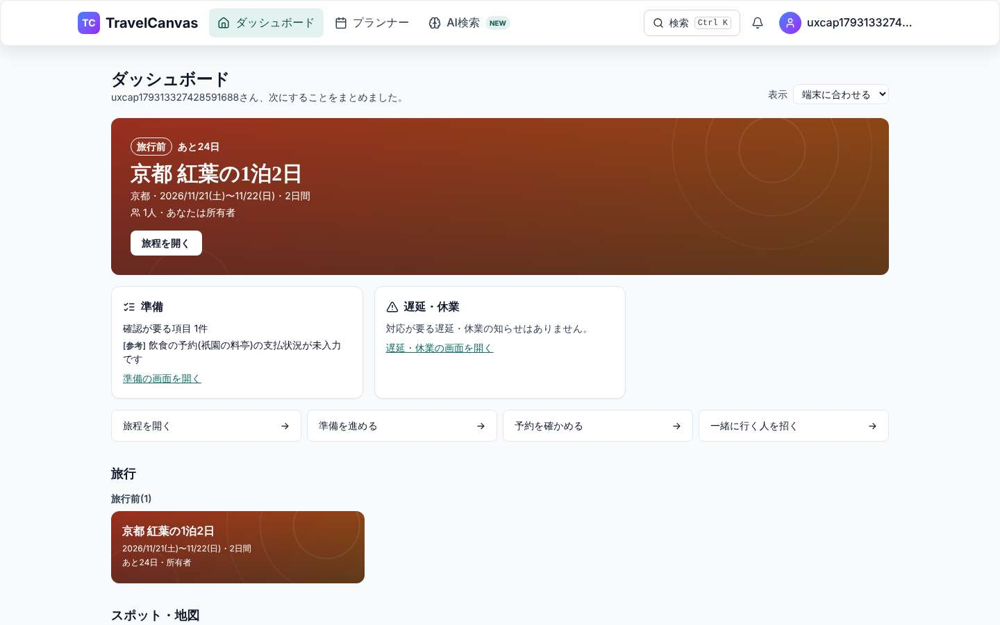 | 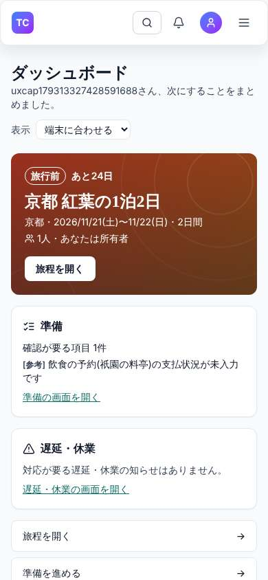 | 続きの旅行を開く | 新しい旅行を始める |
| プランナー(`/planner/:id`) | 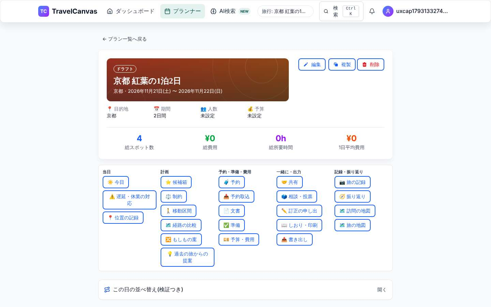 | 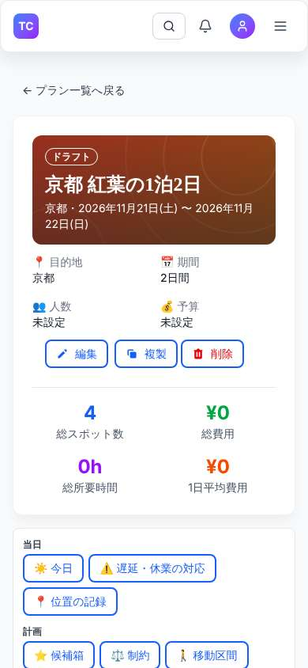 | 日ごとの予定を並べ・直す | 予約・今日・共有へ移る |
| 今日(`/planner/:id/today`) | 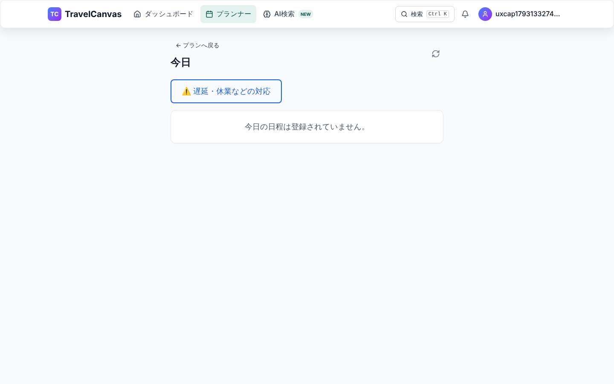 | 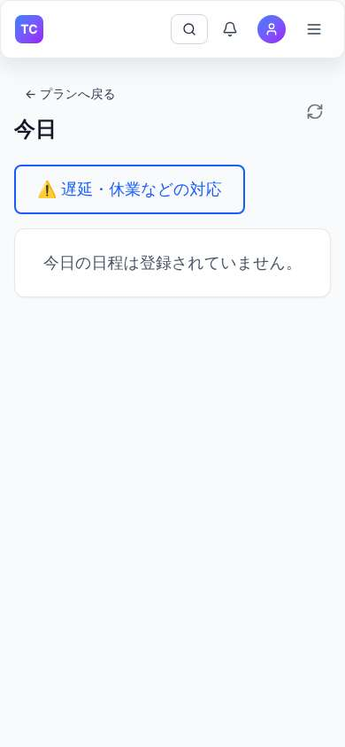 | NOW/NEXT を見て次へ動く | 遅延・休業の対応 |
| 予約(`/planner/:id/reservations`) | 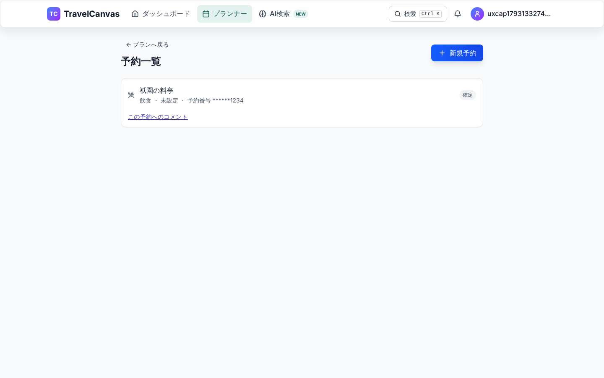 | 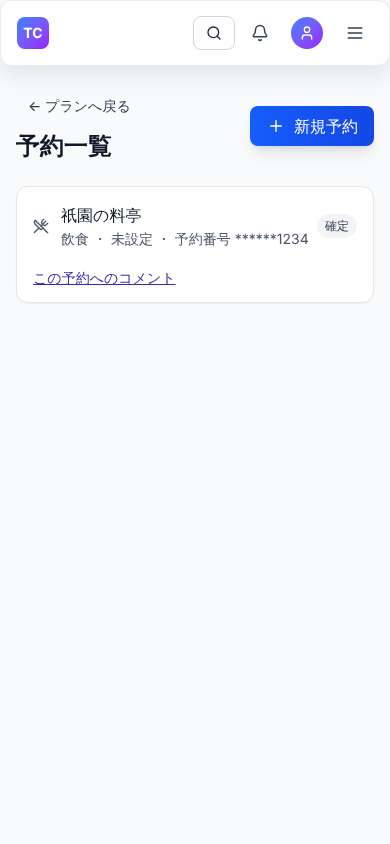 | 予約を探し、番号・チケットを出す | 予約を足す |
| 共有(`/share/:id`) | 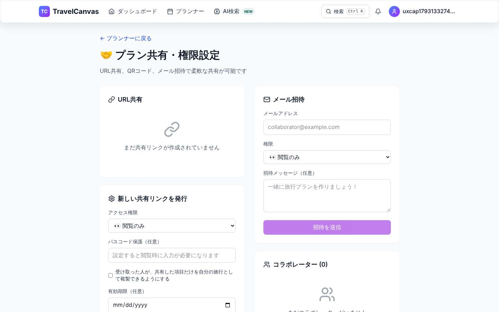 | 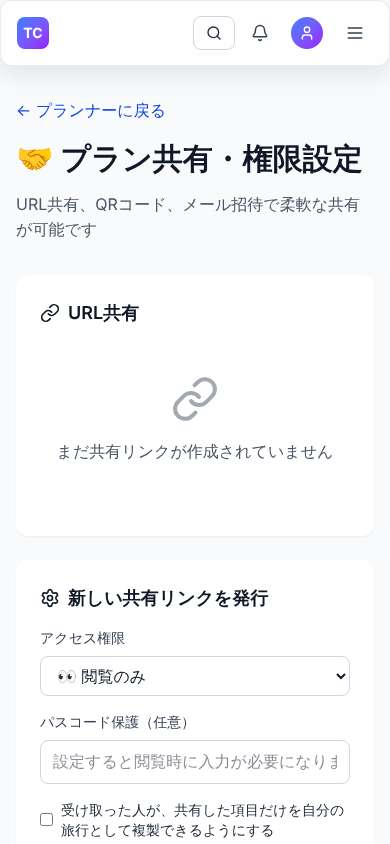 | 一緒に行く人を招く・見せる範囲を決める | 共有の取り消し・所有者の移譲 |
| 設定(`/settings`) | 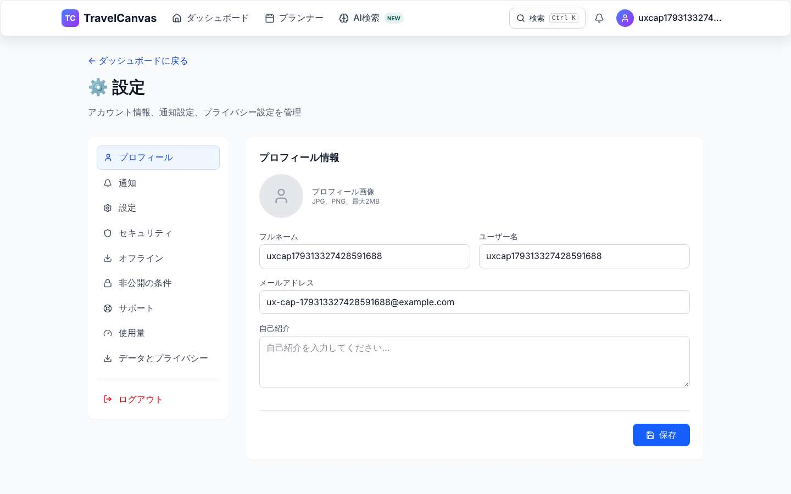 | 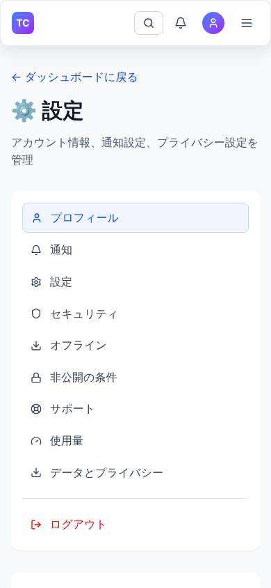 | プロフィール・通知・セキュリティを直す | データとプライバシー |

## 2. 見つけたこと

### 2.1 この Gate で直したもの(機能が壊れていた・読めなかった)

| 画面 | 内容 | 直し方 |
|---|---|---|
| プランナー(PC・スマホ) | 旅行の操作のボタン(23個)を1行に詰めていたため、左端の「予約」「今日」が画面の外に出て**押せなかった** | 折り返す(`planner-actions`)。§3 で全ボタンが画面の中にあることを確かめる |
| プランナー | 日付の無い旅行の情報で「Invalid Date 〜 Invalid Date」「1日間」「人」「¥」と出た | 日程の日付を優先し、無ければ「未設定」 |
| プランナー(スマホ) | 旅行の題名が1文字ずつ折り返した | スマホの幅では題名と操作を縦に並べる |
| 全画面(スマホ) | ヘッダーのアカウントのボタン・メニューのボタンに名前が無かった(axe button-name) | 名前を付ける(見た目は変えない) |
| ダッシュボード・お知らせ ほか | 時刻などの補足の文字のコントラスト不足(gray-400、2.6:1。axe color-contrast) | gray-600 にする(操作のアイコンは gray-500) |

### 2.2 UX-2 以降で直すもの(今は動くが、使いにくい)

| 画面 | 内容 | 予定 |
|---|---|---|
| 全画面(PC) | ヘッダーの項目名が折り返す(「ダッシュボー/ド」「AI検/索」)。「AI検索」が2か所にある | **直した**(G9 後半 UX-3。§5) |
| プランナー | 操作のボタンが23個並び、優先度が分からない(最も多い作業の「予定を直す」より上にある) | **直した**(G9 後半 UX-3。表紙の見出しの後に5つのまとまり。§5) |
| ダッシュボード | 「登録スポット・お気に入り・訪問済み」の数が最上段で、旅行の一覧が無い(続きの旅行へは「最近の活動」かヘッダーの「プランナー」から) | **直した**(G9 後半 UX-2・UX-4。§5) |
| 今日 | 旅行の日でない時は空の案内だけ(次の旅行の日・準備へ案内しない) | UX-4 当日の画面 |
| 設定(スマホ) | 左の項目の一覧が上に縦に長く並び、本文まで遠い | UX-6 |
| 全画面 | Tailwind の色を直に使っている(デザインの決まりに未移行) | UX-6 で `Surface` とデザインの決まりへ置き換える |

## 3. 壊してはいけない所(CI で確かめる)

`frontend/e2e/ux-baseline.spec.ts` が 6画面 × 5つの幅(1440・1024・768・390・360。G9 後半で 1024・768・360 を足した)で確かめる:

1. 本文の目印(`main`)と見出し(`h1`)が1つずつある(読み上げで迷わない)
2. 横にはみ出さない(スマホで横に動かさずに全部読める)
3. その画面の主な情報がある(旅行の名前・予定・予約の名前)
4. 予約番号はそのままの形で出さない(伏せて表示)。「Invalid Date」を出さない
5. プランナーの操作のボタンが全て画面の中にある(押せる)
6. axe(WCAG 2.1 AA)違反が無い

## 4. 撮り直し方

```bash
# 画面と backend を起動した状態で(omega-dev2 は docker compose)
cd frontend && npx playwright test -c playwright.ux.config.ts
# docs/ux/baseline/*.jpg が上書きされる。改修の前後で見比べ、意図した変化だけであることを確かめる
```

## 5. G9 後半(UX-2〜UX-4)の後の基準と、意図した変化

| 画面 | 旅行中(PC) | 旅行中(タブレット 768px) | 旅行中(スマホ) | 暗い(PC) | 暗い(スマホ) |
|---|---|---|---|---|---|
| ダッシュボード | 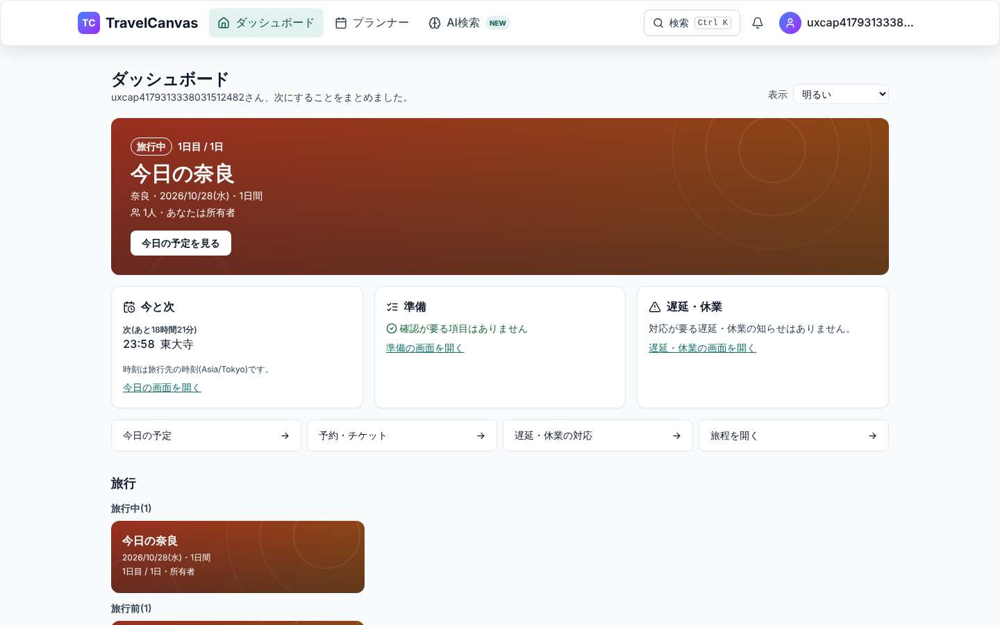 | 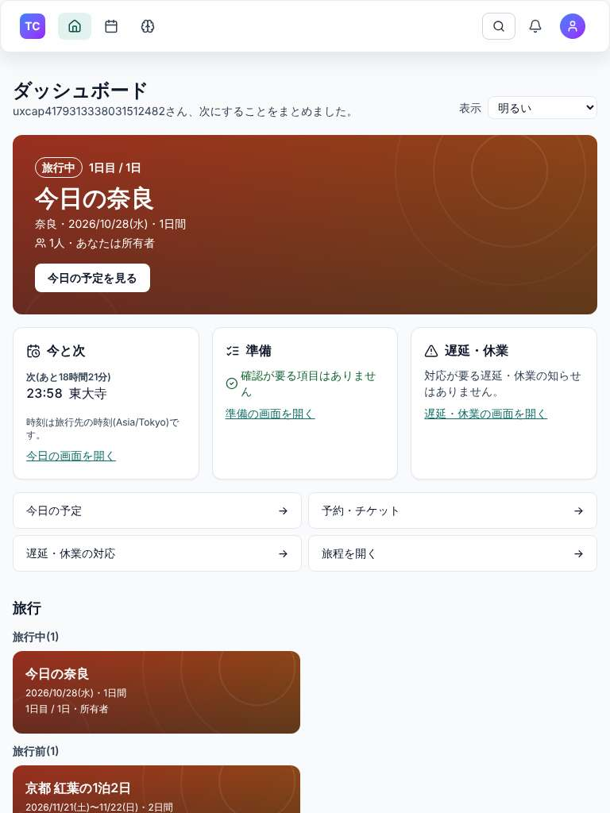 | 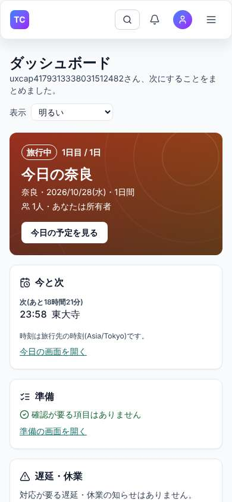 | 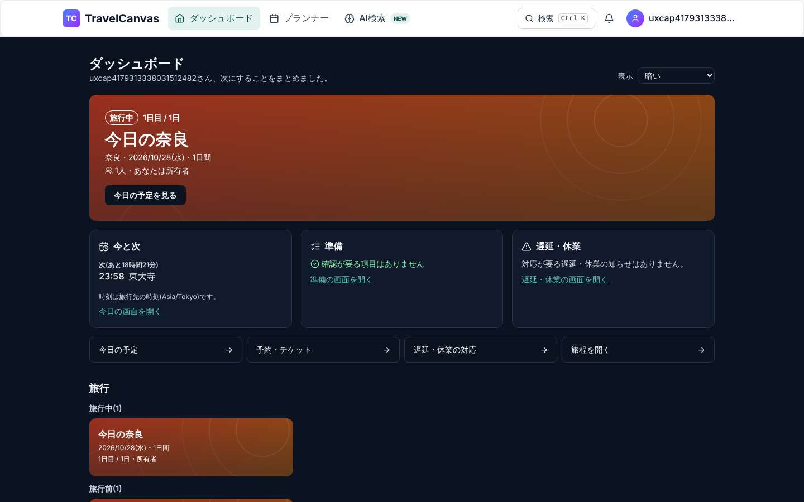 | 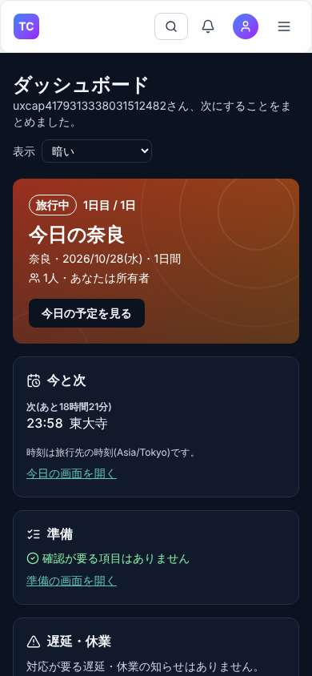 |

意図した変化(撮り直した画像と §1 の改修の前の画像の違い):

| 画面 | 変化 | 判断 |
|---|---|---|
| 全画面 | 見出しの帯がすりガラスの面(tokens)になり、項目名は折り返さない(md〜lg はアイコンだけ)。「AI検索」のボタン・設定のアイコン・点滅する印が無くなった | ADR-ux-information-design §2.2 |
| ダッシュボード | 最上段がスポットの数から「焦点の旅行の表紙」(旅行が無ければ「最初の旅行を始めましょう」)になり、今と次・準備・遅延と休業・操作(最大4つ)・段階ごとの旅行の一覧が続く。スポットの数と擬似的な「最近の活動」は外した(スポット・地図への入口は残す) | ADR-ux-information-design §2.1 |
| プランナー | 旅行名を表紙の見出しにし(青い日付の箱は外した)、23個の入口をその後に5つのまとまりで並べた | ADR-ux-information-design §2.2 |
| 今日・予約・共有・設定 | 見出しの帯だけが変わった(本文は変えていない) | — |
